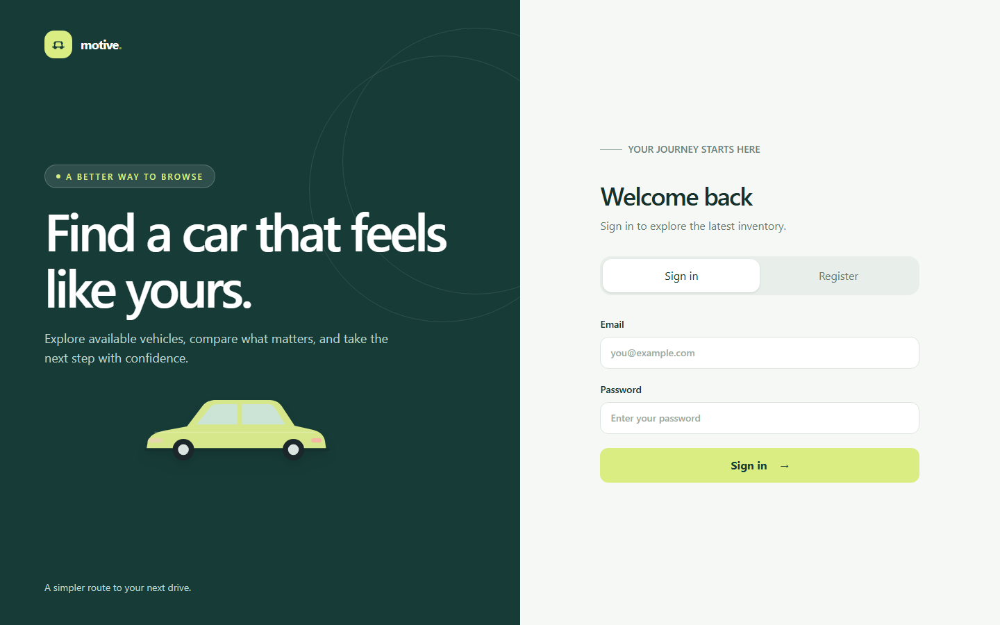
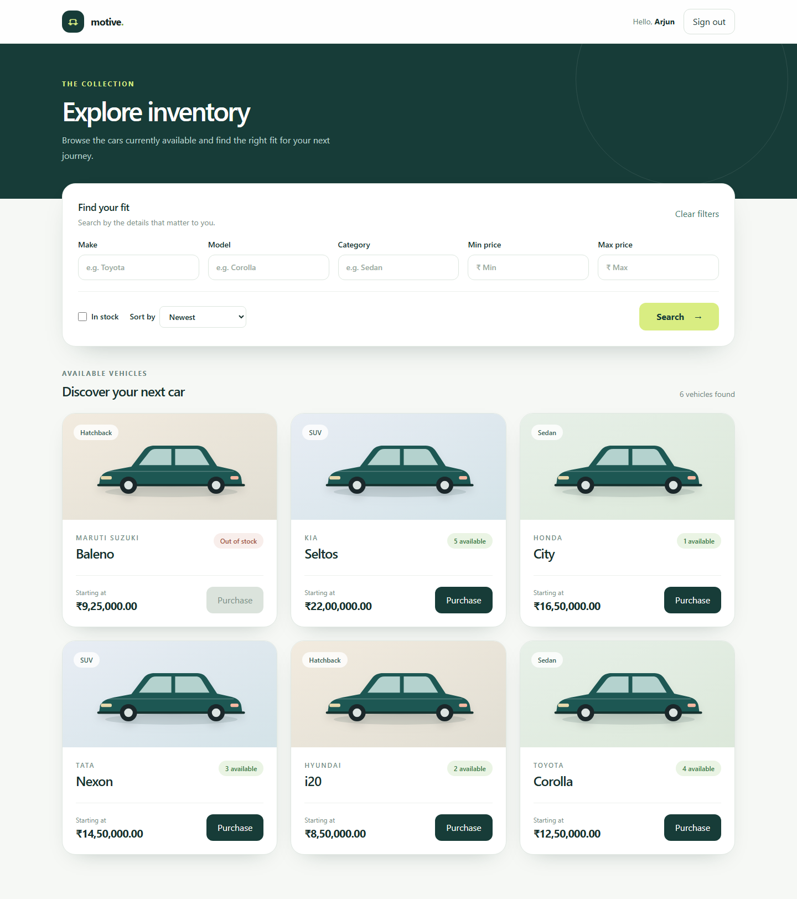
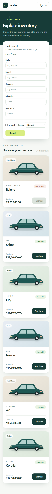
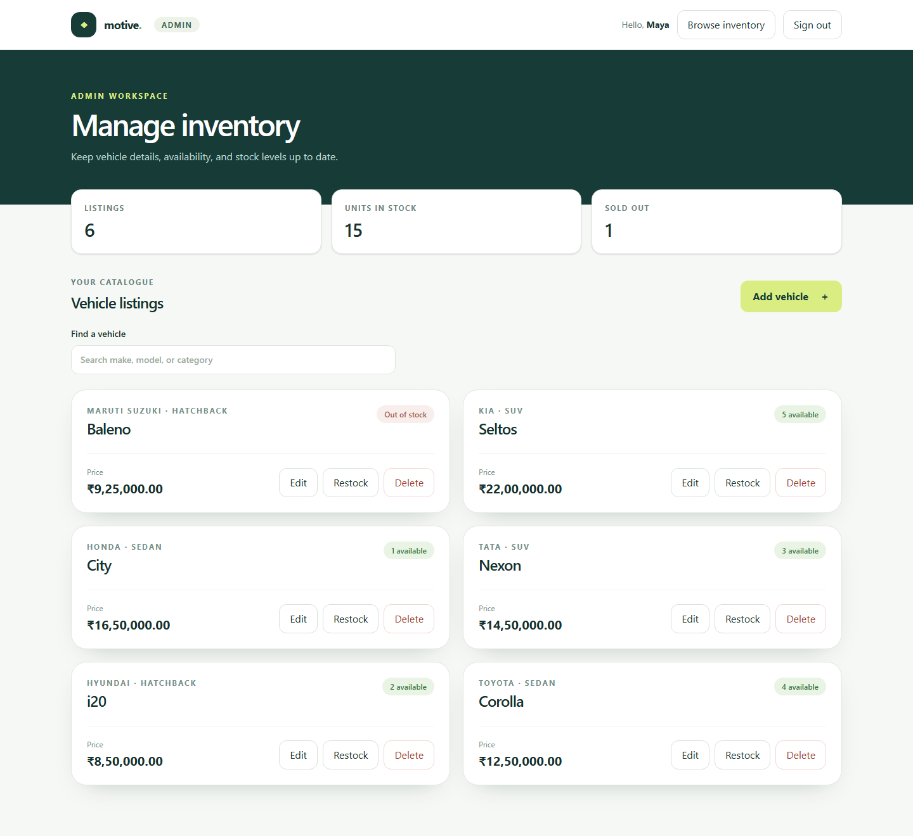
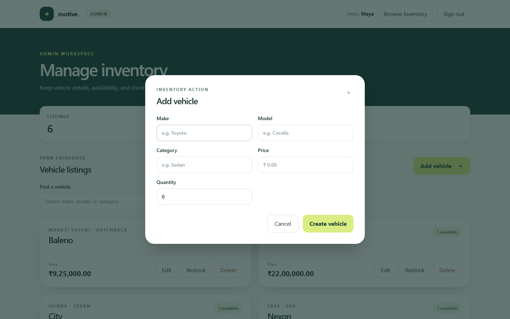

# Car Dealership Inventory System

A full-stack inventory application for a car dealership. Customers can register, sign in, search the catalogue, and purchase one available unit. Administrators can add listings, update vehicle details, restock, and delete listings. A purchase changes stock only; payment and order processing are outside this kata.

Public source: [Sheerkd/car-dealership-inventory-system](https://github.com/Sheerkd/car-dealership-inventory-system).

## Features

| Area | Included behavior |
| --- | --- |
| Accounts | Registration, login, 15-minute bearer tokens, and `USER`/`ADMIN` roles |
| Catalogue | Protected vehicle listing and detail; search by make, model, category, price, and stock; sorting and pagination |
| Inventory | One-unit purchase with an atomic PostgreSQL stock update; admin restocking |
| Administration | Vehicle creation, editing, deletion with confirmation, and a stock overview |
| Customer interface | Responsive sign-in, registration, catalogue, filters, and purchase states |
| Quality | API, database, React, and browser tests; type checks, production builds, and a GitHub Actions workflow |

Public registration always creates a regular user. Vehicle viewing and purchasing require a signed-in account; changes to listings and stock replenishment require an administrator. Sold-out vehicles remain visible, with purchasing disabled.

## Architecture and stack

`React + Vite + Tailwind` → `Express 5 + TypeScript` → `Prisma 6` → `PostgreSQL 17`.

The API validates requests with Zod, hashes passwords with bcrypt, and signs short-lived JWTs with `jose`. Prices are stored as PostgreSQL decimals and returned as strings; the interface displays them in INR. The browser keeps its access token in memory, so a page reload requires a new sign-in. See the [architecture](docs/architecture.md), [API contract](docs/api-contract.md), and [phased plan](docs/implementation-plan.md).

## Run locally

Use Node.js 22, pnpm 11.25.0, and Docker with Compose. The checked-in workflow uses those Node and pnpm versions. Run these commands from the repository root.

1. Install dependencies: `pnpm install --frozen-lockfile`.
2. Copy [`.env.example`](.env.example) to `apps/api/.env`. Set a new random `JWT_SECRET` of at least 32 characters, and replace `ADMIN_NAME`, `ADMIN_EMAIL`, and `ADMIN_PASSWORD`. The admin password must have at least 12 characters. The sample `DATABASE_URL` matches the Compose database. Keep the `.env` file private.
3. Start PostgreSQL with `docker compose up -d db`.
4. Run `pnpm --filter @dealership/api db:generate` and `pnpm --filter @dealership/api db:deploy` to generate the Prisma client and apply the existing migrations.
5. Run `pnpm --filter @dealership/api admin:create` once to create the first administrator. It refuses to replace an account with the configured email; public registration cannot create an admin.
6. Run `pnpm dev` to start the API and frontend. Open the URL printed by Vite, normally `http://localhost:5173`. The API health check is `http://localhost:3001/api/health`. Sign in with the admin credentials for management or register a customer account in the browser.

The web app calls `http://localhost:3001` by default. If the API runs elsewhere, create `apps/web/.env` with `VITE_API_URL=<api-origin>`. Set `CORS_ORIGIN` in `apps/api/.env` to the frontend origin when it differs from `http://localhost:5173`. If you change the database port in `compose.yaml`, update `DATABASE_URL` too. The [API contract](docs/api-contract.md) lists routes, request bodies, responses, and errors.

## Check the project

The default commands check types, run tests that do not require a live database, and build both applications:

```sh
pnpm typecheck
pnpm test
pnpm build
```

For the **full database suite**, use a disposable PostgreSQL database with migrations applied and an admin created. Set `RUN_DB_TESTS=1`, `TEST_ADMIN_EMAIL`, and `TEST_ADMIN_PASSWORD` to that admin's credentials before `pnpm test`. For example, in PowerShell:

```powershell
$env:RUN_DB_TESTS = '1'
$env:TEST_ADMIN_EMAIL = 'your-admin@example.com'
$env:TEST_ADMIN_PASSWORD = 'your-admin-password'
pnpm test
```

To run the browser journey, install Playwright Chromium and use the same test admin variables:

```sh
pnpm exec playwright install --only-shell chromium
pnpm test:e2e
```

The browser test creates a customer and a temporary vehicle listing, then runs customer purchase and admin management against the same database. Run it only against a disposable database. The CI workflow repeats the full sequence on pushes and pull requests using a PostgreSQL service. The [Checks run for commit `39c7e54`](https://github.com/Sheerkd/car-dealership-inventory-system/actions/runs/40202548172) passed; the [test report](docs/test-report.md) distinguishes this remote result from local verification.

## Application screenshots

**Sign in**



**Customer catalogue**



**Customer catalogue on a phone**



**Admin inventory**



**Add a vehicle**



The earlier [sold-out purchase](docs/screenshots/phase6-sold-out.png) and [admin management](docs/screenshots/phase7-admin.png) captures record the browser checks from Phases 6 and 7.

## My AI Usage

I used **OpenAI Codex** to work through this project phase by phase. The conversation began with architecture and an implementation plan based on the supplied brief. Codex generated and revised the TypeScript API, Prisma schema and migrations, React interface, automated tests, browser journey, CI workflow, and documentation. I used the conversation to direct the order of phases and the requested style of AI disclosure. The verbatim conversation records are in [PROMPTS.md](PROMPTS.md).

Codex also ran the local checks reported in the [test report](docs/test-report.md): a frozen install from a temporary clean checkout, migration and admin setup against PostgreSQL, 35 API tests, 20 frontend tests, type checks, builds, and one Playwright journey. These were **automated checks executed by Codex**. Human code edits and manual test execution have not been recorded, so they are not claimed here. The initial implementation is recorded in AI-authored snapshot commit `ac3e882`; it does not establish a red–green–refactor history for Phases 1–8.

AI helped move from the requirements to an integrated application quickly, especially across the API, database, interface, and tests. It also made verification essential: generated code still needed checks against a real PostgreSQL database, concurrency cases, and the browser workflow. The local and CI results establish what passed in those environments; they do not replace a contributor's own review. The snapshot is authored by Codex, without a human co-author claim. Future human-authored commits with AI assistance should describe the actual work and include an AI co-author trailer, while describing manual work only when it was performed.
